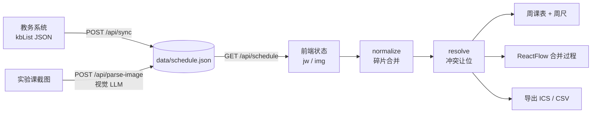

# AI Schedule Sync · 课表校对室

> 教务课表是校样，实验课截图是红笔修改。

一个给大学生自用的轻量课表工具：从教务系统**真实抓取**学期课表，再用视觉模型**解析老师发来的实验课截图**，把「真实的实验教室」合并回课表，最后导出为日历文件。

不接数据库、不做鉴权、不收集任何数据。

---

## 为什么需要它

大学教务系统里的**实验课教室信息经常是错的**——老师往往临时发一张 Excel 或截图通知真实的实验地点。手工对表既费时又容易错。

本工具把这条链路自动化：

1. 用教务 Cookie 同步基础课表（官方数据）
2. 上传实验课截图，由视觉 LLM 提取结构化课程
3. 按「实验课优先」规则自动合并，冲突周次让位
4. 一键导出 `.ics` / `.csv`，导入手机日历或 Excel

---

## 功能

- **教务同步**：Cookie + 学年/学期 → POST 教务 `kbList` 接口 → 课程条目
- **截图解析**：拖拽上传实验课截图，前端自动压缩（≤8MB、长边 ≤2000px），后端用视觉模型提取结构化 JSON，逐行校验、无效项丢弃
- **重复收拢**：同一门课「每周一行」的碎片自动合并为一条（周次取并集），教室名写法变体（`A406` / `信息楼A406` / `本部校区信息楼A406房间`）自动归一并保留多数写法
- **冲突合并**：实验课 > 课程设计 > 理论课；同类型时图片解析 > 教务数据。被占用的周次从低优先级课程中剔除，减空即删除；真正换教室的课不会被误合并
- **可视化**：周尺（大号周数 + 学期刻度条，今天是红刻度）+ 周课表网格 + ReactFlow 合并过程图
- **导出**：全量或指定周次的 `.ics`（随周展开的日历事件）/ `.csv`（Excel 直接打开不乱码）
- **本地优先**：课表存本地 JSON，Cookie 与 API Key 只存浏览器

---

## 技术栈

| 层 | 选型 |
| --- | --- |
| 框架 | Next.js 16（App Router）+ React 19 + TypeScript |
| 样式 | Tailwind CSS v4（`app/globals.css` 内 `@theme inline`） |
| LLM | Vercel AI SDK v7（`generateText` + `Output.object`）+ `@ai-sdk/openai-compatible` |
| 图可视化 | `@xyflow/react` v12 |
| 组件 | 自建 shadcn 风格 primitives（Radix + cva） |
| 测试 | Vitest（76 个用例） |
| 字体 | Newsreader（衬线/数字）+ Archivo（界面） |

界面遵循 `DESIGN.md` 的「纸面校样」设计系统。

---

## 快速开始

**环境要求**：Node.js 22+、npm。

```bash
npm install
npm run dev        # http://localhost:3000
```

生产构建：

```bash
npm run build
npm start
```

其他命令：

| 命令 | 作用 |
| --- | --- |
| `npm run lint` | ESLint |
| `npm run typecheck` | `tsc --noEmit` |
| `npm test` | Vitest 单测 |
| `npm run test:watch` | 监听模式 |

首次打开是空课表，按下面流程走一遍即可。

---

## 使用流程

### 1. 获取教务 Cookie

1. 浏览器登录 `http://jwjxnew.njit.edu.cn`（需要校园网或学校 VPN）
2. 按 `F12` → **Network** → 随便点一个请求 → **Request Headers** → 复制整行 `Cookie`
3. 粘贴到顶栏「教务 Cookie」（密码框，只存在你浏览器里）

### 2. 选择学年学期

默认 `2026-2027 第一学期`（教务参数 `xnm=2026&xqm=3`，第二学期为 `xqm=12`），点「同步教务课表」。

### 3. 配置模型（可选，用于截图解析）

顶栏「模型设置」里填 **同一平台** 的 API Key 与接口地址：

| Key 来源 | Base URL | 模型 |
| --- | --- | --- |
| OpenRouter（`sk-or-…`） | `https://openrouter.ai/api/v1` | `xiaomi/mimo-v2.5` |
| 小米 MiMo 平台 | `https://api.xiaomimimo.com/v1` | `mimo-v2.5` |

> 其他 OpenAI 兼容端点同样可用（填对应 Base URL 与模型名）。

### 4. 上传实验课截图

把老师发的截图拖进「实验课截图」区域，解析成功后课程会以红笔修正的形式并入课表。原图不会保存，只保留解析结果。

### 5. 导出

「导出范围」选全部周次或指定周次（`1-16`、`1,3,5` 均可），导出 `.ics` 或 `.csv`。

---

## 项目结构

```
.
├─ app/
│  ├─ layout.tsx                  # 根布局：字体变量、页面元信息
│  ├─ globals.css                 # 设计系统 tokens（纸面/墨/靛青/校对红）+ 工具类
│  ├─ page.tsx                    # 单页工作区：状态编排、localStorage、同步/重置
│  └─ api/
│     ├─ sync/route.ts            # POST 教务同步：Cookie + xnm/xqm → kbList → CourseItem[]
│     ├─ parse-image/route.ts     # POST 截图解析：multipart → 视觉 LLM → 结构化课程
│     └─ schedule/route.ts        # GET 读取本地课表 / DELETE 重置
│
├─ components/
│  ├─ top-bar.tsx                 # 页眉：Cookie、学年学期、同步按钮、模型设置
│  ├─ schedule-grid.tsx           # 周尺（学期刻度）+ 周课表网格 + 调整批注
│  ├─ image-uploader.tsx          # 拖拽上传、canvas 压缩、逐张解析状态
│  ├─ merge-flow.tsx              # ReactFlow：教务 + 截图 → 校对合并 → 结果
│  ├─ export-bar.tsx              # 导出范围选择与 ICS/CSV 下载
│  └─ ui/                         # 基础组件：button / input / card / badge / label / select
│
├─ lib/
│  ├─ types.ts                    # CourseItem 类型 + LLM 宽容 Zod schema
│  ├─ constants.ts                # 学期起点、五大节作息、类型/来源优先级
│  ├─ parse.ts                    # 周次、节次、星期、日期→周次的容错解析
│  ├─ normalize.ts                # 同课碎片合并（周次并集、教室名归一）
│  ├─ resolve.ts                  # 冲突合并（高优先级占格让位）+ 裁剪报告
│  ├─ jw.ts                       # 教务接口抓取与 kbList 解析（仅服务端）
│  ├─ llm.ts                      # 视觉模型提示词、行→课程转换、JSON 兜底提取
│  ├─ storage.ts                  # data/schedule.json 原子读写（tmp + rename）
│  ├─ ics.ts                      # ICS 生成（floating time、逐周展开、75 字节折叠）
│  ├─ csv.ts                      # CSV 生成（utf-8-sig BOM）
│  └─ utils.ts                    # cn() 类名合并
│
├─ test/                          # Vitest 单测
│  ├─ parse.test.ts               # 周次/节次/星期/周次推算
│  ├─ normalize.test.ts           # 碎片合并、教室名归一、换教室不误合并
│  ├─ resolve.test.ts             # 优先级裁剪、让位周次归属
│  ├─ ics.test.ts                 # 跨月日期、单双周、指定周、行折叠
│  ├─ csv.test.ts                 # BOM、转义、字段
│  └─ llm.test.ts                 # 模型输出容错解析与兜底提取
│
├─ data/schedule.json            # 运行时课表数据（已 gitignore）
├─ DESIGN.md                     # 设计系统：纸面校样
├─ AGENTS.md                     # 协作代理规范与项目命令
└─ PROMPT.md                     # 需求说明
```

---

## 数据流



合并是**纯前端函数**（`lib/normalize.ts` + `lib/resolve.ts`），保证课表、合并图、导出三处结果一致。

---

## 数据模型

```ts
interface CourseItem {
  name: string;      // 课程名
  day: number;       // 1=周一 … 7=周日
  periods: number[]; // 节次，如 [1, 2]
  weeks: number[];   // 周次，如 [1, 2, 7]
  place: string;     // 地点，如 "A406"
  teacher: string;   // 教师
  kind: "theory" | "lab" | "practice";
  src: "jw" | "img"; // 教务 / 截图解析
  project?: string;  // 实验项目名（图片解析附带）
}
```

本地存储格式（`data/schedule.json`）：

```json
{ "jw": [], "img": [], "updatedAt": "2026-10-17T15:28:11.054Z" }
```

---

## API

| 方法 | 路径 | 说明 |
| --- | --- | --- |
| `POST` | `/api/sync` | `{ cookie, xnm, xqm }` → 覆盖 `jw`，返回 `{ schedule, count }`；Cookie 失效返回 `400` 与明确提示 |
| `POST` | `/api/parse-image` | `multipart`：`image` + `apiKey` + `baseURL` + `model` → 追加 `img`，返回 `{ schedule, items, dropped }` |
| `GET` | `/api/schedule` | 读取本地课表 |
| `DELETE` | `/api/schedule` | 清空本地课表 |

错误响应统一为 `{ error: string }`，且尽量给出可操作的修复提示（如 Cookie 过期、Key 与 Base URL 不匹配）。

---

## 核心规则

**解析容错**（`lib/parse.ts`）：`"1-16周"`、`"3-16周(单)"`、`"1,3,5"`、`[7,11]` 都能解析成周次数组；`"周三"` / `"星期三"` / `3` 都能识别星期；没有周次列时按日期推算学期周。

**合并优先级**（`lib/resolve.ts`）：`lab(2) > practice(1) > theory(0)`，同类型时 `img > jw`。只有**严格更高**优先级才裁剪对方的周次；同优先级共存。

**ICS 映射**（`lib/ics.ts`）：学期第 1 周从 `2026-08-31` 开始；真实作息 1-2 节 `08:00–09:40`、3-4 节 `10:10–11:20`、5-6 节 `13:40–15:20`、7-8 节 `15:40–17:00`、9-10 节 `18:30–20:10`；逐周展开事件，时间用 floating local time（不带 `Z`），行宽超过 75 字节自动折叠。

**CSV**（`lib/csv.ts`）：`utf-8-sig`（带 BOM），列为 课程名 / 星期 / 节次 / 周次 / 地点 / 教师 / 类型 / 来源。

---

## 隐私与存储

- **无账号体系、无数据库、无遥测**。
- 教务 Cookie（`ass.cookie`）与模型配置（`ass.llm`）只存浏览器 `localStorage`，不写入服务器文件。
- 课表数据保存在 `data/schedule.json`（已加入 `.gitignore`），可随时用「重置本地数据」清空。
- 上传的截图只在请求内存中处理，**不落盘**，只保留解析结果。

---

## 常见问题

**同步报「响应不是 JSON，Cookie 已失效」**
教务接口在未登录时返回 HTML。重新登录教务系统取最新 Cookie；接口需要校园网或学校 VPN。

**截图解析报「Missing Authentication header」**
这是 OpenRouter 对**无法识别的 Key** 的误导性文案（不是真的缺请求头）。检查 Key 与 Base URL 是否属于同一平台，见上文「配置模型」。

**图片解析出来没有课程**
模型可能返回了无法识别的 JSON。界面会提示丢弃行数与上游原文；换一个支持图像输入的模型再试。

**解析出很多重复课程**
已由 `lib/normalize.ts` 自动合并（同课同格周次取并集）。若仍重复，通常是教室确实是两个不同地点，属于真实信息。

**换电脑后 Cookie 和 Key 没了**
它们只存当前浏览器。重新填写即可，课表数据在 `data/schedule.json` 里不受影响。

---

## 测试

```bash
npm test
```

覆盖核心纯逻辑：周次/节次解析（含单双周）、学期周推算、冲突裁剪与让位归属、碎片合并与教室归一、ICS 跨月/指定周/行折叠、CSV BOM 与转义、LLM 输出兜底提取。

---

## 相关文档

- `DESIGN.md` — 设计系统（纸面校样：纸色、墨色、靛青与校对红、排版、组件规范）
- `AGENTS.md` — 项目命令与协作规范
- `PROMPT.md` — 原始需求
